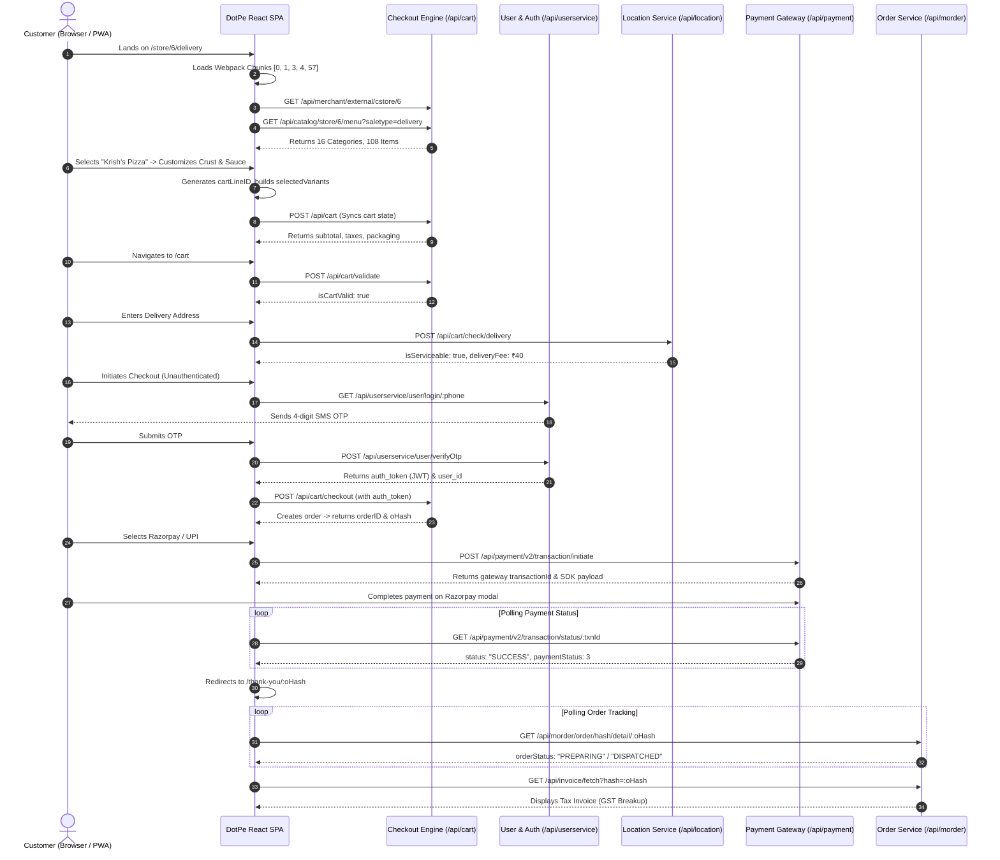

# DotPe Architecture & Order Processing Deep Dive
## Reverse Engineering 1441 Pizzeria (`https://1441pizzeria.dotpe.in/store/6/delivery`)

This document provides a comprehensive technical breakdown of DotPe's frontend and backend architecture, reverse-engineered from production JavaScript bundles, Webpack runtime dictionaries, Redux state trees, and API traffic.

---

## 1. System Architecture Overview

DotPe operates as an omnichannel commerce platform powering food & beverage brands, retail, and direct-to-consumer digital ordering. The ordering interface is built as a modular React Single-Page Application (SPA) backed by cloud-native microservices.

```mermaid
graph TD
    Client["Client Browser / Mobile PWA / WebView<br/>(React 16 SPA + Redux + Redux-Saga)"]
    
    subgraph DotPe Edge & CDN
        Cloudflare["Edge CDN / WAF<br/>(cdn.dotpe.in)"]
        IndexOrigin["Web Origin<br/>(1441pizzeria.dotpe.in)"]
    end
    
    subgraph Microservice Mesh (api.dotpe.in)
        CatalogService["Catalog & Menu Service<br/>(/api/catalog/*, /api/merchant/*)"]
        CartService["Cart & Checkout Engine<br/>(/api/cart/*)"]
        UserService["Customer & Auth Service<br/>(/api/userservice/*)"]
        LocationService["Location & Serviceability<br/>(/api/location/*)"]
        PaymentService["Payment & Gateway Gateway<br/>(/api/payment/*)"]
        OrderService["M-Order & Fulfillment<br/>(/api/morder/*, /api/invoice/*)"]
        PromoService["Promotions & Loyalty<br/>(/api/promo/*, /api/loyalty/*)"]
    end
    
    subgraph External Gateways & Third Parties
        Razorpay["Razorpay / Juspay / PayU"]
        Logistics["Shadowfax / Dunzo / Shiprocket"]
        SMS["Gupshup / Kaleyra OTP"]
    end

    Client --> Cloudflare
    Client --> IndexOrigin
    Client -->|Axios REST APIs| CatalogService
    Client -->|Cart Sync & Validation| CartService
    Client -->|Customer Auth & Addresses| UserService
    Client -->|Geocoding & Radius Check| LocationService
    Client -->|Transaction Initiation| PaymentService
    Client -->|Polling Order State| OrderService
    Client -->|Coupon / Loyalty Points| PromoService
    
    PaymentService --> Razorpay
    UserService --> SMS
    CartService --> Logistics
```

### Key Technical Specs
- **Frontend Stack**: React 16.14+, Redux, Redux-Saga for async side-effects, Axios with interceptors, Webpack 4 code splitting.
- **Client App Sources**: Browser (`dotpe`), Google Pay Spot (`gpayspot`), PhonePe Switch (`phonepe`), Paytm Mini (`paytm-mini`), PWA (`pwa`), DotPe Native WebView (`dotpe_webview`).
- **State Persistence**: Serialized Redux slices saved to `localStorage.getItem("state")` on every store mutation.
- **Backend API Base**: `https://api.dotpe.in` (Subscriptions: `https://subscription.dotpe.in/v1/`, Reports: `https://report-api.dotpe.in`).
- **CDN Base**: `https://cdn.dotpe.in/cfe/` and `https://cdn.dotpe.in/static/assets/`.

---

## 2. Frontend Bundle & Route Splitting Architecture

DotPe implements aggressive route-based code splitting using Webpack dynamic imports (`Promise.all([a.e(...)]).then(...)`). The Webpack runtime embedded in `index.html` indexes **195 JavaScript chunks** and **195 CSS chunks**.

### Webpack Runtime Resolution Mapping
In `index.html`, chunk IDs map to hashes via an inline runtime dictionary:
```javascript
// Webpack Chunk Map Sample:
{
  0: "003b05f8", 1: "fba0a7d5", 2: "d6f9dc85", 3: "9a588f56", 4: "d78ebbb8",
  31: "a0b21baa", 57: "2b876dfd", 58: "7912ff5e", 59: "b1bba8bb", 61: "df374a84",
  66: "74d89cee", 72: "57a651f1", 104: "273c1583", 126: "d0df0b26", 150: "b21cfaf2"
}
```

### Route-to-Chunk Mapping Table

| Application Route | Component Var | Chunk IDs Loaded | Bundle File Names | Description |
| :--- | :---: | :--- | :--- | :--- |
| `/store/:cstoreid/delivery` | `ve` | `[0, 3, 4, 1, 57]` | `57.2b876dfd.chunk.js`, `1.fba0a7d5.chunk.js`, `0.003b05f8.chunk.js` | Main Storefront & Category View |
| `/store/:cstoreid/pickup` | `ve` | `[0, 3, 4, 1, 57]` | `57.2b876dfd.chunk.js` | Takeaway / Pickup Storefront |
| `/catalog/:categoryId` | `pe` | `[32, 72]` | `72.57a651f1.chunk.js`, `32.6966b7a9.chunk.js` | Category Catalog Grid |
| `/cart` | `he` | `[3, 4, 31, 1, 59]` | `59.b1bba8bb.chunk.js`, `31.a0b21baa.chunk.js` | Active Cart, Bill Summary & Upsell |
| `/item/:itemId` | `Ae` | `[0, 153]` | `153.14ab12d2.chunk.js`, `0.003b05f8.chunk.js` | Standalone Item Customization Page |
| `/search` | `Ne` | `[0, 3, 84, 1, 61]` | `61.df374a84.chunk.js`, `84.715cd682.chunk.js` | Item & Category Search |
| `/delivery-address` | `je` | `[Inlined]` | `main.cc65a752.chunk.js` | Map Pin & Address Entry Form |
| `/delivery-address-list` | `_e` | `[Inlined]` | `main.cc65a752.chunk.js` | Saved Addresses Selector |
| `/verify-otp` | `Ye` | `[150]` | `150.b21cfaf2.chunk.js` | OTP Verification Modal / Screen |
| `/payment` | `S` | `[Inlined]` | `main.cc65a752.chunk.js` | Gateway & Payment Mode Selector |
| `/payment/processing/:txnId` | `j` | `[Inlined]` | `main.cc65a752.chunk.js` | Polling Screen for Gateway Callback |
| `/thank-you/:oHash` | `De` | `[66]` | `66.74d89cee.chunk.js` | Real-time Live Order Status & Tracking |
| `/invoice/:hash` | `Le` | `[126]` | `126.d0df0b26.chunk.js` | Tax Invoice View & PDF Download |
| `/profile` | `ct` | `[3, 33, 63]` | `63.be27f141.chunk.js` | Customer Profile & Saved Details |
| `/loyalty` | `lt` | `[1, 62]` | `62.3d862467.chunk.js` | Loyalty Rewards Balance & History |

---

## 3. Redux State Management & Persistence

DotPe persists critical slices of the Redux state to `localStorage.getItem("state")` on every Redux dispatch via a store subscriber.

```javascript
// From main.cc65a752.chunk.js:
store.subscribe(() => {
  try {
    const state = {
      clusterReducer: store.getState().clusterReducer,
      clusterCartReducer: store.getState().clusterCartReducer,
      checkoutReducer: store.getState().checkoutReducer,
      paymentMethodsReducer: store.getState().paymentMethodsReducer,
      userReducer: store.getState().userReducer,
      deliveryReducer: store.getState().deliveryReducer,
      storeReducer: store.getState().storeReducer,
      postpaidReducer: store.getState().postpaidReducer,
      promotionReducer: store.getState().promotionReducer,
      commonReducer: store.getState().commonReducer
    };
    localStorage.setItem("state", JSON.stringify(state));
  } catch (err) {}
});
```

### Key Reducer Slices

#### 1. `storeReducer`
Holds the merchant profile, store settings, catalogs, and category hierarchies:
- `storeInfo`: Store details (ID, name, merchantId, contact, service flags, tax configs).
- `storeMenu`: Complete menu hierarchy containing `categories`, `menuItems`, and `preorderFlags`.
- `filteredStoreMenu`: Active menu filtered by veg/non-veg flags or search query.
- `promoBanners`: Store-level promotional banners and slider assets.

#### 2. `checkoutReducer`
Controls the active cart, pricing calculations, item customizations, and order creation:
```javascript
const checkoutInitialState = {
  checkoutCart: {},              // Validated cart returned from backend
  superCart: { storeCart: { default: {} } },
  isCartValid: false,            // True when /api/cart/validate returns status: true
  modifiedItems: {},             // Items modified due to price/stock changes
  removedItems: {},              // Out-of-stock items removed by server
  newCheckoutCart: {},           // Proposed cart updates
  cartItemsCount: 0,             // Total units
  deliveryBagData: {},           // Packaging charge metadata
  currentCartPayload: {},        // Serialized payload for /api/cart
  previousCartPayload: {},       // Previous snapshot for rollback
  orderData: {},                 // Created order record ({ orderID, oHash, ... })
  ongoingOrderDetails: {},       // Live order tracking details
  paymentData: {},               // Gateway transaction payload
  pullPayment: "",               // Payment polling outcome ("SUCCESS", "FAILED")
  placeOrderFailed: false
};
```

#### 3. `userReducer`
Stores the authenticated customer profile, session token, and active addresses:
- `user`: `{ user_id, phone, full_name, email }`
- `authToken`: JWT token passed in `Authorization: Bearer <token>`
- `savedAddresses`: Array of user address records
- `selectedAddress`: Currently active delivery address

---

## 4. Cart Logic & Item Customization Architecture

### In-Memory Representation vs. Backend Serialization
In the frontend, items are grouped by `itemID` inside `cartItems`. If an item is customizable (like pizzas with sizes, crusts, sauces, and toppings), multiple instances are held inside an `items` array under that item ID, differentiated by a unique `cartLineID`.

```javascript
// In-Memory Redux Cart Structure:
cartItems: {
  "101": {
    itemID: 101,
    quantity: 2,                 // Aggregate quantity of all variants for item 101
    basePrice: 499.00,
    isCustomizable: "Y",
    itemSaleType: "delivery",
    itemType: "standard",
    items: [
      {
        cartLineID: "line_a91b2c",
        itemID: 101,
        itemName: "Krish's Pizza",
        price: 499.00,
        itemQty: 1,
        selectedVariants: {
          "crust": "Thin Crust",
          "sauce": "Mama's Secret Sauce",
          "cheese": "Smoked Mozzarella"
        },
        optionVariants: {
          "1": ["opt_thin_crust"],
          "2": ["opt_mamas_sauce"],
          "3": ["opt_jalapenos", "opt_sundried_tomatoes"]
        }
      },
      {
        cartLineID: "line_c83d4e",
        itemID: 101,
        itemName: "Krish's Pizza",
        price: 619.00,          // Cheese Burst variant (+120)
        itemQty: 1,
        selectedVariants: {
          "crust": "Cheese Burst",
          "sauce": "Peri Peri"
        }
      }
    ]
  }
}
```

### Customization Deduplication Algorithm
When a user adds or edits an item in the customization modal, DotPe compares the new `selectedVariants` and `price` against existing lines for that `itemID`:
```javascript
// Reverse-engineered from chunk 58 (58.7912ff5e.chunk.js):
let matchIndex = -1;
existingItems.forEach((existingLine, idx) => {
  if (
    JSON.stringify(existingLine.selectedVariants) === JSON.stringify(newVariants) &&
    existingLine.price === newItem.price
  ) {
    matchIndex = idx;
  }
});

if (matchIndex !== -1) {
  // Exact customization match: Increment line quantity
  existingItems[matchIndex].itemQty += 1;
} else {
  // Distinct customization: Push as new line item instance
  newItem.cartLineID = generateUUID();
  existingItems.push({ ...newItem, itemQty: 1 });
}
```

### Flattened Backend Payload
Before dispatching to `/api/cart` or `/api/cart/checkout`, the nested `cartItems` map is flattened into an `items` array with `categoryID` attached:
```json
{
  "storeID": 6,
  "merchantID": 1001,
  "cartID": "cart_1441_892183",
  "saleType": "delivery",
  "serviceSubtype": "delivery",
  "cartQuantity": 2,
  "instruction": "Please make it crispy",
  "phone": "9876543210",
  "userName": "Ricco",
  "userInfo": {
    "phone": "9876543210",
    "userName": "Ricco",
    "address": {
      "latitude": 19.2183,
      "longitude": 72.9781,
      "address1": "Flat 402, Sunshine Heights",
      "address2": "Ghodbunder Road",
      "city": "Thane",
      "pincode": "400607",
      "tag": "Home"
    }
  },
  "items": [
    {
      "itemID": 101,
      "categoryID": 1,
      "itemName": "Krish's Pizza",
      "itemQty": 1,
      "price": 499.00,
      "cartLineID": "line_a91b2c",
      "selectedVariants": {
        "crust": "Thin Crust",
        "sauce": "Mama's Secret Sauce"
      }
    },
    {
      "itemID": 101,
      "categoryID": 1,
      "itemName": "Krish's Pizza",
      "itemQty": 1,
      "price": 619.00,
      "cartLineID": "line_c83d4e",
      "selectedVariants": {
        "crust": "Cheese Burst",
        "sauce": "Peri Peri"
      }
    }
  ]
}
```

---

## 5. DotPe REST API Endpoint Catalog

All requests include the common headers:
```http
Content-Type: application/json
app_version: 1.0.1
session_id: <uuid>
Authorization: Bearer <jwt_token> (when authenticated)
```

### 5.1 Catalog & Store Metadata Service

#### `GET /api/merchant/external/cstore/:cstoreId`
- **Purpose**: Fetch store configuration, operating hours, delivery radius, and branding.
- **Query Params**: `?saleType=delivery`
- **Response**:
```json
{
  "status": true,
  "data": {
    "store": {
      "storeId": 6,
      "storeName": "1441 Pizzeria - Thane",
      "merchantId": 1001,
      "address": "Viviana Mall, Eastern Express Highway, Thane West",
      "phone": "+919876543210",
      "city": "Thane",
      "lat": 19.2085,
      "lng": 72.9715,
      "storeServices": {
        "delivery": true,
        "pickup": true,
        "instore": ["takeaway"]
      },
      "configs": {
        "UITemplateData": {
          "primaryColorCode": "#D32F2F",
          "secondaryColorCode": "#FFC107"
        },
        "taxConfig": { "gstPercentage": 5.0 },
        "packagingCharges": 25.0
      }
    },
    "merchant": {
      "merchantId": 1001,
      "merchantName": "1441 Pizzeria",
      "logo": "https://cdn.dotpe.in/merchants/1441/logo.png"
    }
  }
}
```

#### `GET /api/catalog/store/:cstoreId/menu`
- **Purpose**: Retrieve full categorised menu hierarchy.
- **Query Params**: `?saletype=delivery`
- **Response**:
```json
{
  "status": true,
  "data": {
    "categories": [
      {
        "categoryId": 1,
        "categoryName": "Recommended Items",
        "itemIDs": [101, 102, 103, 104, 105]
      },
      {
        "categoryId": 2,
        "categoryName": "Woodfired Pizzas",
        "itemIDs": [201, 202, 203]
      }
    ],
    "menuItems": {
      "101": {
        "itemID": 101,
        "itemName": "Krish's Pizza",
        "price": 499.0,
        "basePrice": 499.0,
        "isCustomizable": "Y",
        "description": "Founder's signature wood-fire pizza.",
        "image": "https://cdn.dotpe.in/items/krish_pizza.jpg",
        "isVegetarian": false,
        "options": [
          {
            "title": "Crust Selection",
            "mandatory": true,
            "options": [
              { "id": "c1", "name": "Classic Thin Crust", "price": 0 },
              { "id": "c2", "name": "Cheese Burst", "price": 120 }
            ]
          }
        ]
      }
    },
    "preorderFlags": { "isPreorderEnabled": false }
  }
}
```

---

### 5.2 Cart & Checkout Service

#### `POST /api/cart`
- **Purpose**: Synchronize local cart state to server; returns server-calculated bill breakdown.
- **Request Body**: Serialized Cart JSON (see section 4).
- **Response**:
```json
{
  "status": true,
  "data": {
    "cartID": "cart_1441_892183",
    "itemTotal": 1118.00,
    "taxes": 55.90,
    "packagingCharges": 25.00,
    "deliveryCharge": 40.00,
    "discount": 0.00,
    "totalPayable": 1238.90,
    "cartQuantity": 2
  }
}
```

#### `POST /api/cart/validate`
- **Purpose**: Pre-checkout validation of item prices, inventory availability, and store open status.
- **Request Body**: `{ "cartID": "cart_1441_892183", "storeID": 6, "items": [...] }`
- **Response**:
```json
{
  "status": true,
  "data": {
    "status": true,
    "isCartValid": true,
    "modifiedItems": {},
    "removedItems": {}
  }
}
```

#### `POST /api/cart/check/delivery`
- **Purpose**: Validate customer coordinate distance against store geofence; returns delivery fee.
- **Request Body**:
```json
{
  "storeID": 6,
  "latitude": 19.2183,
  "longitude": 72.9781,
  "cartAmount": 1118.00
}
```
- **Response**:
```json
{
  "status": true,
  "data": {
    "isServiceable": true,
    "deliveryFee": 40.00,
    "estimatedDeliveryTimeMinutes": 35,
    "minOrderAmount": 200.00
  }
}
```

#### `POST /api/cart/checkout`
- **Purpose**: Convert cart into a locked order; generates `orderID` and secure `oHash`.
- **Request Body**: Complete validated cart with customer phone, delivery address, instructions.
- **Response**:
```json
{
  "status": true,
  "data": {
    "status": true,
    "orderID": "DP1441-98721",
    "oHash": "a1b2c3d4e5f6g7h8",
    "payAmount": 1238.90,
    "remainingAmount": 1238.90,
    "paymentMethods": ["razorpay", "juspay", "amazonPay", "simpl", "cod"]
  }
}
```

---

### 5.3 Customer Authentication & Address Management

#### `GET /api/userservice/user/login/:phone`
- **Purpose**: Trigger SMS OTP verification to customer.
- **Response**:
```json
{
  "status": true,
  "data": {
    "otpSent": true,
    "message": "OTP sent successfully to +919876543210"
  }
}
```

#### `POST /api/userservice/user/verifyOtp`
- **Purpose**: Verify OTP code and return auth credentials.
- **Request Body**:
```json
{
  "phone": "9876543210",
  "otp": "1234",
  "name": "Ricco",
  "service": "enterprise_customer",
  "serviceSubtype": "delivery",
  "storeId": 6,
  "merchantId": 1001,
  "loyaltyConsent": true
}
```
- **Response**:
```json
{
  "status": true,
  "data": {
    "auth_token": "eyJhbGciOiJIUzI1NiIsInR5cCI...",
    "user_id": "usr_99812",
    "user": {
      "phone": "9876543210",
      "userName": "Ricco"
    }
  }
}
```

#### `POST /api/userservice/address/create`
- **Purpose**: Save customer delivery address to profile.
- **Request Body**:
```json
{
  "phone": "9876543210",
  "address1": "Flat 402, Sunshine Heights",
  "address2": "Ghodbunder Road",
  "city": "Thane",
  "pincode": "400607",
  "tag": "Home",
  "latitude": 19.2183,
  "longitude": 72.9781
}
```
- **Response**:
```json
{ "status": true, "data": { "addressId": "addr_441" } }
```

---

### 5.4 Payment & Gateway Processing Service

#### `GET /api/payment/v2/modes`
- **Purpose**: Fetch enabled payment gateways and channels for store/merchant.
- **Query Params**: `?merchantId=1001&storeId=6&service=outstore&subType=delivery`
- **Response**:
```json
{
  "status": true,
  "data": {
    "modes": [
      { "id": "razorpay", "name": "Cards / UPI / NetBanking", "type": "gateway" },
      { "id": "simpl", "name": "Simpl 1-Tap Pay Later", "type": "paylater" },
      { "id": "cod", "name": "Cash on Delivery", "type": "offline" }
    ]
  }
}
```

#### `POST /api/payment/v2/transaction/initiate`
- **Purpose**: Initiate payment gateway session or generate UPI Intent link.
- **Request Body**:
```json
{
  "orderID": "DP1441-98721",
  "paymentMethod": "razorpay",
  "payAmount": 1238.90,
  "customerPhone": "9876543210",
  "merchantID": 1001,
  "returnURL": "https://1441pizzeria.dotpe.in/payment/processing"
}
```
- **Response**:
```json
{
  "status": true,
  "data": {
    "transactionId": "txn_8871239",
    "status": "INITIATED",
    "gatewayOrderId": "order_Rzp892182",
    "key": "rzp_live_xxxxxxxx",
    "amount": 123890
  }
}
```

#### `GET /api/payment/v2/transaction/status/:transactionId`
- **Purpose**: Client polls this endpoint while awaiting gateway callback.
- **Response**:
```json
{
  "status": 200,
  "data": {
    "status": "SUCCESS",
    "transactionId": "txn_8871239",
    "orderID": "DP1441-98721",
    "oHash": "a1b2c3d4e5f6g7h8",
    "paymentStatus": 3
  }
}
```

---

### 5.5 Order Lifecycle, Fulfillment & Invoicing

#### `GET /api/morder/order/hash/detail/:oHash`
- **Purpose**: Live polling of order fulfillment status displayed on `/thank-you/:oHash`.
- **Response**:
```json
{
  "status": true,
  "orderDetails": {
    "orderID": "DP1441-98721",
    "oHash": "a1b2c3d4e5f6g7h8",
    "orderStatus": "PREPARING",
    "paymentStatus": 3,
    "paymentMethod": "Razorpay",
    "createdAt": "2026-10-11T18:00:00Z",
    "deliveryTimeMinutes": 30,
    "items": [
      { "name": "Krish's Pizza", "quantity": 1, "price": 499.0 },
      { "name": "Krish's Pizza (Cheese Burst)", "quantity": 1, "price": 619.0 }
    ],
    "billingDetails": {
      "itemTotal": 1118.0,
      "taxes": 55.9,
      "packaging": 25.0,
      "delivery": 40.0,
      "total": 1238.9
    },
    "deliveryDetails": {
      "address": "Flat 402, Sunshine Heights, Ghodbunder Road, Thane 400607",
      "customerPhone": "9876543210"
    }
  }
}
```

#### `GET /api/invoice/fetch?hash=:oHash`
- **Purpose**: Return tax invoice details and PDF download link.
- **Response**:
```json
{
  "status": true,
  "data": {
    "invoiceNumber": "INV-1441-2026-9921",
    "gstin": "27AABCU9603R1ZM",
    "pdfUrl": "https://cdn.dotpe.in/invoices/INV-1441-2026-9921.pdf",
    "breakup": {
      "cgst": 27.95,
      "sgst": 27.95,
      "totalTax": 55.90
    }
  }
}
```

---

## 6. End-to-End Order & Payment State Machine



---

## 7. Security, Headers & Session Lifecycle

1. **Session Fingerprinting**: The frontend generates a persistent `sess-id` stored in cookie/localStorage and transmits it on every request via `headers["session_id"]`.
2. **Version Pinning**: Every Axios request sends `app_version: "1.0.1"`, allowing DotPe's API gateway to enforce deprecation policies or serve targeted feature flags.
3. **JWT Bearer Authentication**: Upon OTP verification, `auth_token` is injected into `Authorization: Bearer <token>` for sensitive checkout operations.
4. **Order Hash (`oHash`)**: Orders are exposed via an unguessable 16-character alphanumeric cryptographic hash, preventing unauthorized sequence enumeration of customer orders.
